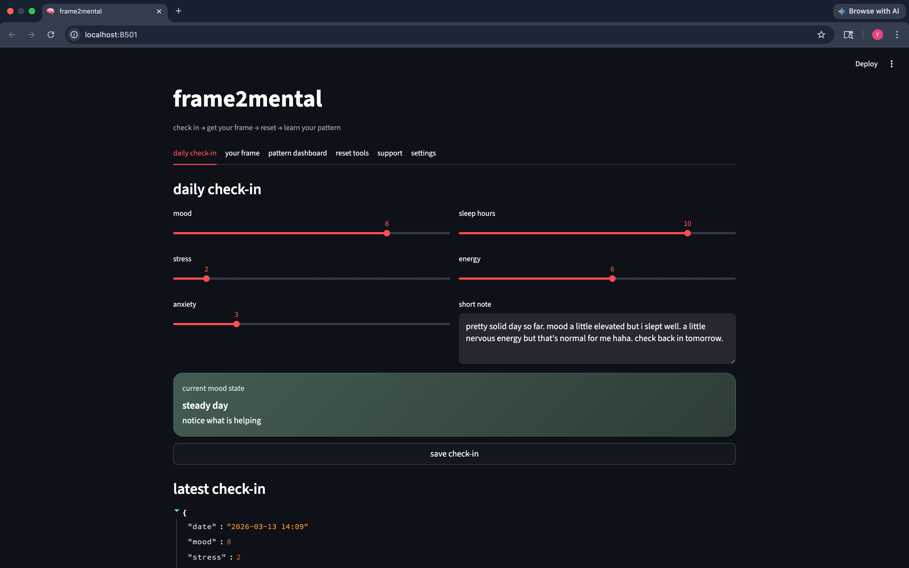
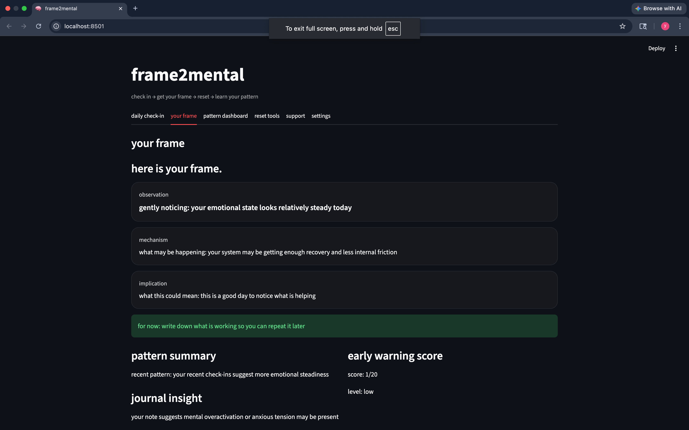
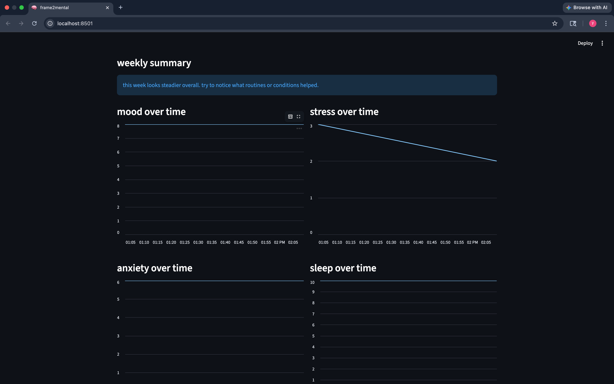
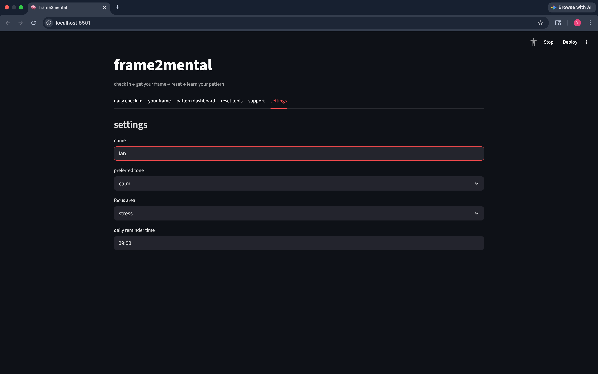

# frame²mental

[](https://github.com/dualityframework-ux/frame2mental/actions/workflows/ci.yml)
[](LICENSE)

> **Not medical advice.** frame²mental is a personal self-awareness tool, not a diagnostic tool and not a substitute for professional care. If you are in crisis in the US, call or text **988** (Suicide & Crisis Lifeline). If you are in immediate danger, call 911.

frame²mental is a lightweight mental awareness app built with **Streamlit** that helps users recognize emotional patterns early and respond with clarity.

It applies the **Frame² model**:

check in → get your frame → reset → learn your pattern

Instead of reacting after emotions escalate, frame²mental helps identify the **mechanisms behind emotional patterns** sooner.

---

# Core Idea

Most mental health tools focus only on tracking mood.

frame2mental focuses on **pattern recognition and interpretation**:

- observation
- mechanism
- implication
- next step

This turns daily check-ins into **actionable insight**.

---

# Features

• daily emotional check-ins  
• frame-based insight engine  
• early warning pattern detection  
• reset plans and grounding tools  
• pattern dashboard with trend tracking  
• journal insight analysis  
• personalized tone (calm / direct / encouraging)  
• persistent user settings  
• CSV export of check-in history  

---

# Daily Check-In

Users log key signals affecting mental state:

- mood
- stress
- anxiety
- sleep
- energy
- short journal note



---

# Frame Insight

The system analyzes the check-in and generates a **Frame** explaining what may be happening.

The output always follows the structure:

- observation
- mechanism
- implication
- next step



---

# Pattern Dashboard

Over time the system visualizes emotional signals to reveal trends.

Tracked signals include:

- mood
- stress
- anxiety
- sleep
- energy

The dashboard helps users identify patterns across days and weeks.



---

# Settings

Users can personalize the experience:

- name
- preferred response tone
- focus area
- daily reminder time

Frame responses automatically adapt to the selected tone.



---

# Architecture

The project uses a modular architecture designed for clarity and expansion.

```
frame2mental
├── app.py (app launcher)
├── renderers.py (UI tabs)
├── engine
│   ├── insights.py
│   ├── warnings.py
│   └── plans.py
├── storage.py (data persistence)
├── styles.py (UI styling)
├── settings.py (user configuration)
└── data.py (tools + resources)
```

---

# Run Locally

```bash
git clone https://github.com/dualityframework-ux/frame2mental.git
cd frame2mental
python3 -m venv .venv
source .venv/bin/activate
python -m pip install -r requirements.txt
python -m streamlit run app.py
```

Then open:

http://localhost:8501

---

# Philosophy

frame²mental is built on a simple idea:

Emotional patterns usually appear **before emotional crises**.

By tracking small signals daily, users can recognize patterns earlier and respond with clarity instead of reaction.

---

# Roadmap

Future improvements may include:

- pattern prediction
- mobile interface
- therapist report export
- notification reminders
- AI-assisted reflections
- encrypted personal data storage

---

# Tests

```bash
python -m pip install -r requirements-dev.txt
python -m pytest -q
```

The tests cover every frame branch, the three tones (including that the direct tone stays grammatical), the warning score and levels, early-warning trends, weekly and pattern summaries, journal keywords, reset plans, check-in and settings storage, and that the 988 crisis line is always listed. GitHub Actions runs them on every push.

---

# Privacy

Check-ins and settings are stored locally in `checkins.json` and `settings.json` on the machine running the app. The data files, previous-version backups, locks and temporary files are git-ignored. Check-in data is not uploaded by the app.

---

# License

MIT — see [LICENSE](LICENSE).

## Reliable local storage

On macOS and Linux, the default data folder is the application directory,
independent of the directory from which you launch it. Set
`FRAME2MENTAL_DATA_DIR` to choose a private folder before starting the app:

```bash
FRAME2MENTAL_DATA_DIR="$HOME/.frame2mental" python -m streamlit run app.py --server.address 127.0.0.1
```

Existing project-local data stays in place. Choosing another folder does not move
or delete it. Copy existing data deliberately if you want to migrate it.

Writes validate the document, use an exclusive file lock and atomic replacement,
and retain the previous valid document as `checkins.json.bak` or
`settings.json.bak`. Newly written files and backups have owner-only permissions.
Appending a check-in reloads the latest history under the lock, so independently
open sessions do not overwrite one another's new entries. Settings and explicit
history replacement still use the latest completed save; this is a personal tool,
not an account-based multi-user service.

Malformed or invalid files stop the app with a recovery message instead of silently
appearing as empty history. Failed writes do not update session history or report
success. Preserve the original file, review a copy of the `.bak` if available, and
restore only after confirming its contents. A backup is the previous version,
not a full version history; the files remain unencrypted local JSON.

The saved reminder time is a preference; this app does not schedule notifications.
The local launcher uses an existing environment and binds to localhost rather
than installing dependencies on every launch. Run the engine, persistence and
Streamlit UI tests with `python -m pytest -q`.
